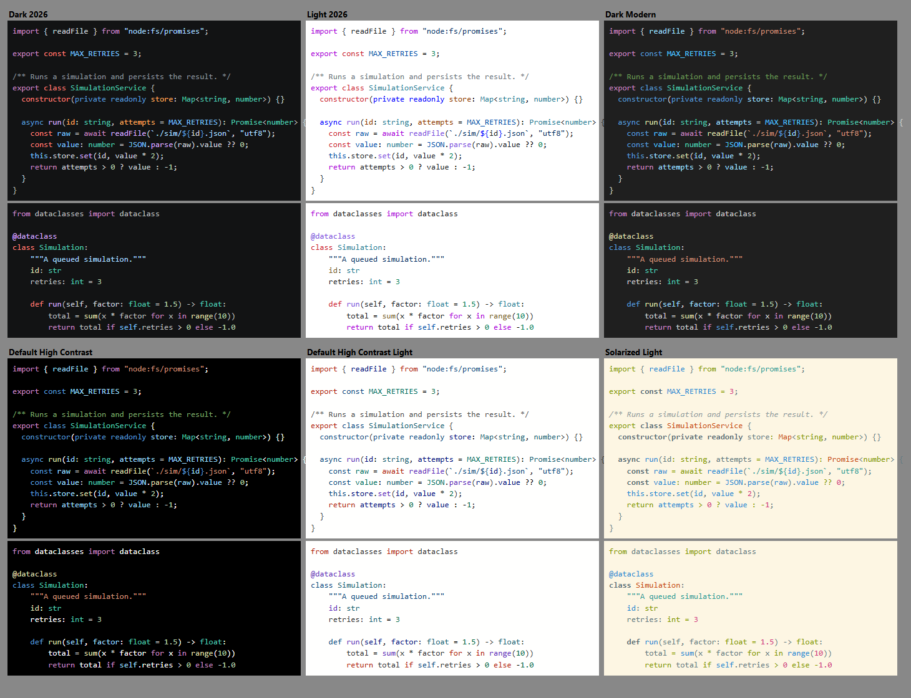

# Spike: theme-matched highlighting in a webview

PUN-002 · November 2026 · VS Code 1.146 (installed) and 1.147 (test host) · Shiki 4.6.0

## Question

Can code in the Punaise webview be highlighted so that it looks like the editor, in light, dark and high-contrast themes, and keep up when the user changes theme?

## Answer

Yes. Use Shiki in the **extension host** with the **active VS Code theme file itself** (not a mapping to a Shiki theme), VS Code's **own TextMate grammars**, and Shiki's **JavaScript regex engine**. Send class-based HTML plus a small stylesheet to the webview. For TypeScript the result matches the editor's TextMate colours exactly and differs from the editor only where semantic highlighting recolours a token (about 2 of 21 identifiers in the sample).

## Approach

1. **Find the active theme.** Read `workbench.colorTheme` (or `workbench.preferredDark/LightColorTheme` when `window.autoDetectColorScheme` is on). Find the extension whose `contributes.themes` entry has that `id` (or `label` when there is no `id`) in `vscode.extensions.all`, which includes built-in extensions.
2. **Load the theme file.** Read it from the contributing extension's folder, parse it as JSONC, and follow `include` chains (Dark 2026 → Dark Modern → Dark+ → Dark (Visual Studio)), concatenating `tokenColors` base-first and merging `colors`. Map `uiTheme` to Shiki's `type` (`vs`, `hc-light` → light; `vs-dark`, `hc-black` → dark). Append `editor.tokenColorCustomizations.textMateRules`.
3. **Load grammars from VS Code.** Take the grammar for a language from the extension that contributes it (`contributes.grammars`), instead of bundling Shiki's language packs.
4. **Highlight in the host** with `createHighlighterCore` and `createJavaScriptRegexEngine`, using `codeToTokens`.
5. **Emit classes, not inline styles.** The webview's CSP (`default-src 'none'; style-src 'nonce-…'`) blocks `style="…"` attributes, which is what Shiki's `codeToHtml` produces. The spike assigns one class per distinct colour and font style and sends a nonce-tagged `<style>` block with them, so the CSP stays strict and the webview needs no scripts.
6. **Follow theme changes** with `vscode.window.onDidChangeActiveColorTheme` and re-render.

The editor background comes from the theme's `editor.background`; the code font comes from the webview's `--vscode-editor-font-family` and `--vscode-editor-font-size` variables.

## What worked

**Matching the editor.** Rendered with six themes: Dark 2026, Light 2026, Dark Modern, Default High Contrast, Default High Contrast Light and Solarized Light (a theme from a separate built-in extension, standing in for marketplace themes). The output carries each theme's background, keyword, string, type, function, comment and constant colours, including bold and italic in Solarized Light and the high-contrast palettes.

**Theme changes.** An integration test switched the editor through five themes (Dark 2026, Light 2026, both High Contrast themes, Solarized Light). After each switch the renderer picked up the new theme and produced that theme's background and palette.

**Grammars and engines agree.** For the TypeScript and Python samples, Shiki's bundled grammars and VS Code's own grammars produced byte-identical output, and so did the Oniguruma (WASM) and JavaScript regex engines. All 242 of Shiki's bundled languages compile and tokenise with the JavaScript engine.

**Speed.** First render about 300 ms (highlighter creation, grammar and theme load). After that, 3–10 ms per render of a 15-line sample, including the first render after a theme change. Cache the highlighter and loaded themes.

## What did not work, or needs care

- **Semantic highlighting is not reproduced.** Shiki only runs TextMate grammars. The editor also recolours some tokens using the language server's semantic tokens (for example a `readonly` property shown in constant colour). For TypeScript in the Modern themes this changed roughly 2 of 21 identifiers in the sample; the estimate is approximate because it applies VS Code's default semantic-to-scope fallbacks by hand. Python with Pylance, which emits more semantic tokens, was not measured because Pylance is not installed in the test host. A later improvement could overlay semantic tokens (`vscode.provideDocumentSemanticTokens` works from the host and was exercised in the spike), but it is not needed to look right.
- **Shiki 4 is ESM-only.** The extension compiles to CommonJS. esbuild bundles it without trouble, but `tsc` (which compiles the integration tests) rejects the import under `module: Node16`. Setting `"module": "Node20"` in `packages/extension/tsconfig.json` fixes it: the test host's Node supports `require()` of ESM. This is a change to shared config, so PUN-006 should make it deliberately.
- **`activeColorTheme.kind` can lag.** Read straight after changing the setting, `kind` sometimes still reported the previous theme. Key the renderer on the theme id from settings, and render in response to `onDidChangeActiveColorTheme`, where both agree.
- **Themes evolve.** Dark 2026 in the 1.147 test build has a different palette from 1.146. Reading the theme at runtime handles this; a fixed mapping to Shiki's bundled themes would not.
- **Gaps not handled by the spike:**
  - themes whose `tokenColors` point to a `.tmTheme` (plist) file rather than JSON
  - per-theme customizations (`"[Theme Name]": {…}`) and the simple `comments`/`strings`/… keys of `editor.tokenColorCustomizations`, and `editor.semanticTokenColorCustomizations`
  - grammars that embed other languages (Markdown, HTML, Vue): their embedded grammars must be loaded too, by following `embeddedLanguages` and `injectTo`
  - an unknown theme id, which should fall back to plain text in the editor's foreground colour

## Bundle size

The current extension bundle is 4 KB. Minified esbuild bundles of the options (gzip in brackets):

| Option | Size |
| --- | --- |
| Shiki core + JavaScript engine, grammars loaded from VS Code at runtime | 166 KB (54 KB) |
| + bundled TypeScript and Python grammars | 418 KB (80 KB) |
| Core + Oniguruma (WASM) engine + TypeScript and Python grammars | 578 KB (222 KB) |
| Full `shiki` package (all languages and themes) | 9.7 MB (1.7 MB) |

No themes need to be bundled in any option, because the active theme is read from disk.

## Webview or host?

The item asked to try Shiki in the webview. It works there too: the same 166 KB core and JavaScript engine run in a browser, and the JavaScript engine avoids the `'wasm-unsafe-eval'` CSP exception that Oniguruma needs. But the webview cannot read theme or grammar files, so the host would have to send them over, and the webview would need `script-src`. Highlighting in the host keeps the webview script-free for now, matches the design rule that the host sends rendered data, and costs a few milliseconds per card.

## Recommendation for PUN-006

- Highlight in the extension host with `shiki/core` and `createJavaScriptRegexEngine`, one cached highlighter for the session.
- Load the active theme from its contributing extension (following `include`) and grammars from VS Code's installed extensions, so any language and theme the editor knows works without bundling.
- Send class-based HTML plus a nonce-tagged stylesheet; keep the CSP strict.
- Re-render all cards on `onDidChangeActiveColorTheme` and on changes to `editor.tokenColorCustomizations`.
- Add `shiki` as a runtime dependency (about 166 KB minified), and set `"module": "Node20"` for the extension's `tsc` build. Both need a human's approval under AGENTS.md.
- Leave semantic-token overlay, `.tmTheme` themes and per-theme customizations for later items.

The spike code is on the branch `spike/pun-002-highlighting`. With it checked out, press F5 to see the sample in the Punaise view; changing the colour theme re-renders it.
